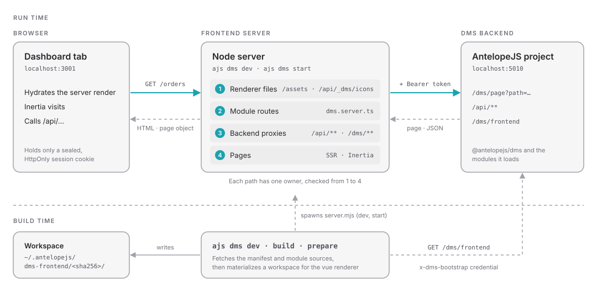

<div align="center">

<picture>
  <source media="(prefers-color-scheme: dark)" srcset="https://raw.githubusercontent.com/AntelopeJS/dms/main/packages/dms/frontend-vue/layers/dms-layout/public/images/antelope-logo/dark.svg">
  
</picture>

# @antelopejs/dms-frontend

<a href="https://www.npmjs.com/package/@antelopejs/dms-frontend"></a>
<a href="./LICENSE"></a>
<a href="https://discord.gg/g4pFt6eXqu"></a>
<a href="https://dms.antelopejs.com/docs/frontend"></a>

**The frontend of the AntelopeJS DMS: the `ajs dms` CLI, the Vue renderer and the frontend-module SDK.**

[Documentation](https://dms.antelopejs.com/docs/frontend) · [DMS](https://github.com/AntelopeJS/dms) · [Modules](https://dms.antelopejs.com/docs/modules)

</div>



## What it does

- Asks a DMS backend which frontend modules it loads, materializes them into a generated workspace, builds it, and runs the frontend server.
- Renders the dashboard with Vue 3, Vite, Inertia and server-side rendering.
- Keeps the backend token on the server: the browser only holds a sealed, `HttpOnly` session cookie, and declared backend prefixes are proxied with the session's token.
- Lets a module extend the dashboard with pages, components and plugins (`dms.frontend.ts`), server routes (`dms.server.ts`) and build-time declarations (`dms.frontend.build.ts`).
- Serves development with hot reload, and production with pre-compressed assets.

## Install

Add the package next to `@antelopejs/core`; the core `ajs` command runs it as `ajs dms`:

```bash
pnpm add -D @antelopejs/core @antelopejs/dms-frontend
```

## Quick start

In a DMS project started with `ajs project run -w`, serve the dashboard with hot reload:

```bash
pnpm exec ajs dms dev
```

For production, build from the project root, without the backend, then start the frontend server with `DMS_SESSION_SECRET` and the backend's secrets set:

```bash
pnpm exec ajs dms build
pnpm exec ajs dms start -b https://api.example.com -p 3001
```

`ajs dms --help` lists every command, and `ajs dms help environment` every environment variable.

## Compatibility

<!-- antelopejs-docs-compat:start -->

| Package            | Supported     | Tested with |
| ------------------ | ------------- | ----------- |
| `@antelopejs/core` | `>=1.16.0 <2` | `1.16.0`    |

<!-- antelopejs-docs-compat:end -->

| `@antelopejs/dms` | `@antelopejs/dms-frontend` |
| --- | --- |
| 0.9.1 and later | `>=0.6.1 <0.7.0` |
| 0.9.0 | `>=0.6.0 <0.7.0` |
| 0.6.0 – 0.8.3 | 0.5 (exact floor per release in the full table) |

The 0.6 line needs Node.js 20.19 or later and `@antelopejs/core` `>=1.13.2 <2`. The [compatibility table](https://dms.antelopejs.com/docs/frontend/introduction#compatibility) lists every release.

## Documentation

- [Introduction](https://dms.antelopejs.com/docs/frontend/introduction) and [Installation](https://dms.antelopejs.com/docs/frontend/installation)
- [CLI reference](https://dms.antelopejs.com/docs/frontend/cli/overview)
- [Configuration and environment variables](https://dms.antelopejs.com/docs/frontend/configuration)
- [Writing a frontend module](https://dms.antelopejs.com/docs/frontend/frontend-modules/anatomy)
- [Rendering model](https://dms.antelopejs.com/docs/frontend/rendering/model)
- [Deploying to production](https://dms.antelopejs.com/docs/frontend/deployment/production)
- [Troubleshooting](https://dms.antelopejs.com/docs/frontend/troubleshooting)

The guide's sources live in [`docs/`](./docs). The package also ships the `dms-frontend` skill for coding agents in [`skills/`](./skills), declared under `antelopeJs.skills`.

## Contributing

Read [CONTRIBUTING.md](./CONTRIBUTING.md) before opening a pull request.

```bash
pnpm install
pnpm build
pnpm lint          # oxlint, oxfmt, interface ranges and the docs reference check
pnpm typecheck
pnpm test
```

`pnpm docs:reference` regenerates the environment-variable table of `docs/4.configuration.md` from the list `ajs dms help environment` prints; `pnpm lint` fails when the table is stale.

## License

[Apache-2.0](./LICENSE)
