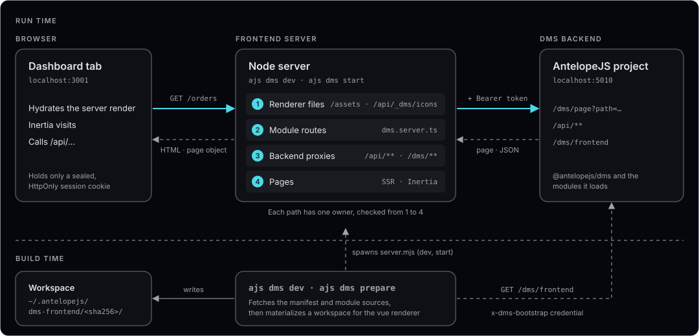

`@antelopejs/dms-frontend` runs the browser-facing part of your DMS project. Start your backend, run `ajs dms dev`, and open the URL it prints to use the dashboard.

## Run your dashboard

In development, a DMS project runs as two processes, each in its own terminal. The backend runs with `pnpm exec ajs project dev -w`, and the frontend runs with `pnpm exec ajs dms dev`:

```bash [Backend terminal]
pnpm exec ajs project dev -w
```

```bash [Frontend terminal]
pnpm exec ajs dms dev
```

The frontend discovers the local backend and prepares the application. Its **Local** URL opens onboarding on a fresh database, and the sign-in flow or the dashboard on an existing project. This first run needs no frontend module code. [Installation](/docs/frontend/installation) walks through it step by step.

To add behavior to a dashboard that already runs, start with [Anatomy of a frontend module](/docs/frontend/frontend-modules/anatomy). For deployment, read [Production](/docs/frontend/deployment/production).

## What the package provides

The package connects the frontend modules of an AntelopeJS project to one application:

- **The `ajs dms` CLI.** It reads the frontend modules of the project, materializes them into a generated workspace, builds it, and runs the frontend server. Its commands are `dev`, `build`, `start`, `prepare`, `workspaces`, `clean`, `verify-source` and `prepare-types`.
- **The Vue renderer.** The workspace it generates is a Vue application served by a Node server, with Vite, Inertia and server-side rendering. `vue` is the only renderer the package ships.
- **The frontend-module SDK.** A module registers its pages, components and plugins in `dms.frontend.ts`, its server routes in `dms.server.ts` and its build-time declarations in `dms.frontend.build.ts`. It imports the SDK through the `#dms/frontend-module`, `#dms/server` and `#dms/frontend-build` aliases.

## How it fits together

The browser only ever talks to the frontend server. The frontend server renders each page from what the backend says the page holds, and answers the routes its modules declare. It forwards the backend prefixes the modules declare, and adds the session's access token to each forwarded request. The token never reaches the browser, which only holds a sealed, `HttpOnly` session cookie.



`build` and `dev` read the frontend modules from the AntelopeJS project. They evaluate its `antelope.config.ts`, and load each installed module that names its frontend in the `dmsFrontend` field of its `package.json`. `build` asks no backend.

`dev` also fetches the frontend manifest from `GET /dms/frontend?renderer=vue&rendererVersion=3`, with the backend's bootstrap credential in the `x-dms-bootstrap` header. The manifest gives it the secrets the backend holds, and tells it when the module store installs or removes a module. `prepare` reads the modules the manifest lists. Both commands read each module in place, from its sources.

`dev` and `prepare` keep their workspace under `~/.antelopejs/dms-frontend/`, one per backend URL. `dev` without `-b` keys its workspace on the project directory instead. `build` writes its workspace to `<project>/.dms-frontend`, and `start` serves it from there.

::card-group
:::card{title="Run it" icon="i-lucide-play" to="/docs/frontend/cli/dev"}
`ajs dms dev` finds the backend of the project you are in and serves the dashboard with hot reload.
:::

:::card{title="Ship it" icon="i-lucide-rocket" to="/docs/frontend/deployment/production"}
`ajs dms build` then `ajs dms start` gives a production server with sessions, a backend proxy and pre-compressed assets.
:::

:::card{title="Extend it" icon="i-lucide-puzzle" to="/docs/frontend/frontend-modules/anatomy"}
A frontend module adds pages, components, server routes, route rules and e-mail templates.
:::

:::card{title="Configure it" icon="i-lucide-settings-2" to="/docs/frontend/configuration"}
Every variable the CLI and the frontend server read, from the shell or the project's `.env`.
:::
::

## Compatibility

The DMS declares the renderer releases its frontend runs on in `engines["@antelopejs/dms-frontend"]` of its frontend module's `package.json`. The CLI refuses to build a module whose range excludes the installed renderer, as [Supported releases](/docs/frontend/frontend-modules/supported-releases) describes. To find the renderer releases that match a DMS release, read that `engines` range in the installed DMS frontend module. This page lists no DMS releases, because that range is what the CLI enforces.

::note
Until the package's first major release, every minor release can break modules, so a module caps its range below the next minor.
::

The renderer package needs the `@antelopejs/core` range in the generated compatibility block of the [README](https://github.com/AntelopeJS/dms-frontend#compatibility). The `engines` field of its `package.json` sets the Node.js versions it runs on. The core's `ajs` command delegates `ajs dms` to this package.

## Renderers

A renderer is the framework a generated workspace is built for. The loader negotiates it with the backend. It asks for `renderer=vue&rendererVersion=3` and refuses a manifest that lists a module for any other renderer. The renderer's own files in the workspace come from `templates/vue/` in this package, and `templates/vue/server.mjs` with `templates/vue/server/` becomes the Node server `ajs dms start` runs.

The package has no `--renderer` flag and no renderer registry, and it makes no promise of renderers for other frameworks. The `dms.frontend.ts` entry and the `#dms/frontend-module` alias belong to the Vue renderer, not to the loader.

## Where to go next

- [Installation](/docs/frontend/installation) adds the CLI to a project and runs it for the first time.
- [Rendering model](/docs/frontend/rendering/model) follows a request from the browser to the backend and back.
- The [Frontend layer](/docs/building/frontend-layer) page of the DMS guide covers the dashboard side: layers, the core frontend module and its composables.
