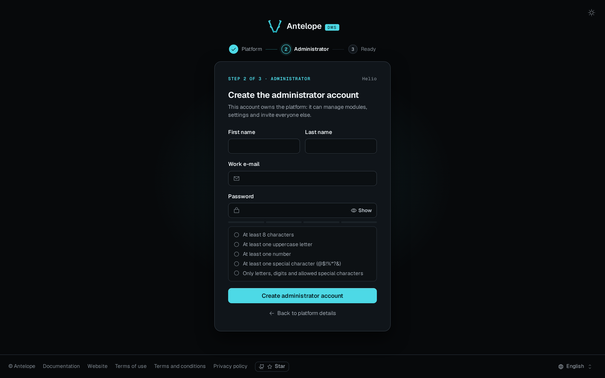

These steps open your DMS dashboard in a browser. You need an existing DMS backend project, because the frontend package does not create one. Install the CLI next to `@antelopejs/core` and run it as `ajs dms <command>`.

## Requirements

- Node.js in the range that the `engines` field of the package's `package.json` sets.
- `@antelopejs/core` in the range listed in the [README compatibility table](https://github.com/AntelopeJS/dms-frontend#compatibility).
- pnpm. The generated workspace installs its dependencies with pnpm, whatever installs the project.
- A DMS backend, which is an AntelopeJS project that loads `@antelopejs/dms` and serves the frontend manifest. The [Compatibility](/docs/frontend/introduction#compatibility) section says where to read the renderer releases that match your DMS.

## Add it to a project

::steps
### Install the packages

A DMS project usually has both already. The DMS templates list `@antelopejs/dms-frontend` in their `devDependencies`.

:::code-group
```bash [In a project]
pnpm add -D @antelopejs/core @antelopejs/dms-frontend
```

```bash [Globally]
pnpm add -g @antelopejs/core @antelopejs/dms-frontend
```
:::

Inside a package script, `ajs` resolves from `node_modules/.bin` and the `dms` command resolves the project's own plugin, so a script never depends on a global install. A global install is for interactive use.

### Add the project scripts

For example, with the backend under `dev` and the frontend commands under a `frontend:` prefix:

```json [package.json]
{
  "scripts": {
    "dev": "ajs project dev -w",
    "frontend:dev": "ajs dms dev",
    "frontend:build": "ajs dms build",
    "frontend:verify": "ajs dms verify-source"
  }
}
```

### Check the installation

```bash [Terminal]
pnpm exec ajs dms --version
```

The command prints the installed `@antelopejs/dms-frontend` version. Check that it fits your DMS frontend module's supported range.
::

## Run the dashboard

The local loop needs two terminals and no configuration. The backend publishes its address in `.antelope/dev.json` and a development credential in `.antelope/dms-dev.json`, and `ajs dms dev` reads both.

::steps
### Start the backend

```bash [Terminal 1]
pnpm dev
```

Wait for `Server started, listening on http://127.0.0.1:5010` in its log.

### Start the frontend

From the project directory, or any directory below it:

```bash [Terminal 2]
pnpm exec ajs dms dev
```

The first run generates a workspace and installs its dependencies. Later runs reuse it. The following output is from a demo run. Timings, ports and modules depend on your project:

```text
ajs dms dev  http://127.0.0.1:5050 · development
ℹ Backend discovered from .
✔ Workspace ready 3.2s
✔ Dev server ready in 7.1s

  ➜  Local:     http://localhost:3005/
     Backend:   http://127.0.0.1:5050
     Workspace: ~/.antelopejs/dms-frontend/8aa5ac7c…
     Secrets:   DMS_HTML_RENDER_SECRET, DMS_OAUTH_RELAY_SECRET from the manifest
     Watching 12 layer sources · Ctrl+C to stop

Routing: renderer files, then 21 module routes, then the backend proxies below, then the pages
  /api/**    -> backend (session), declared by antelopejs__dms-frontend-vue
  /dms/**    -> backend (session), declared by antelopejs__dms-frontend-vue
  /ai/**     -> backend (session), declared by @antelopejs/dms-assistant-frontend-vue
  /i18n/**   -> backend (none), declared by @antelopejs/dms-lang-frontend-vue
  /media/**  -> backend (session), declared by @antelopejs/dms-media-frontend-vue
```

This run used the DMS demo template on ports 5050 and 3005. With the defaults, the backend answers on 5010 and the dashboard on 3001.

### Open the dashboard

Open the `Local` URL. A fresh database starts on the onboarding page, which creates the platform and its first administrator.
::



The image shows the **Administrator** step, which follows the platform details. Follow the [onboarding walkthrough](/docs/getting-started/built-in-dashboard#first-run-the-onboarding-wizard) for the complete sequence. A database that already has an administrator opens the [built-in sign-in screen](/docs/auth-and-tenancy/authentication).

::tip
`ajs dms dev` listens on `127.0.0.1` only. Set `HOST=0.0.0.0` to reach the development server from another machine.
::

## Next steps

- [CLI overview](/docs/frontend/cli/overview) lists every command and the options they share.
- [Configuration](/docs/frontend/configuration) explains the `.env` files and every variable.
- [Production](/docs/frontend/deployment/production) builds and serves the dashboard for real traffic.
