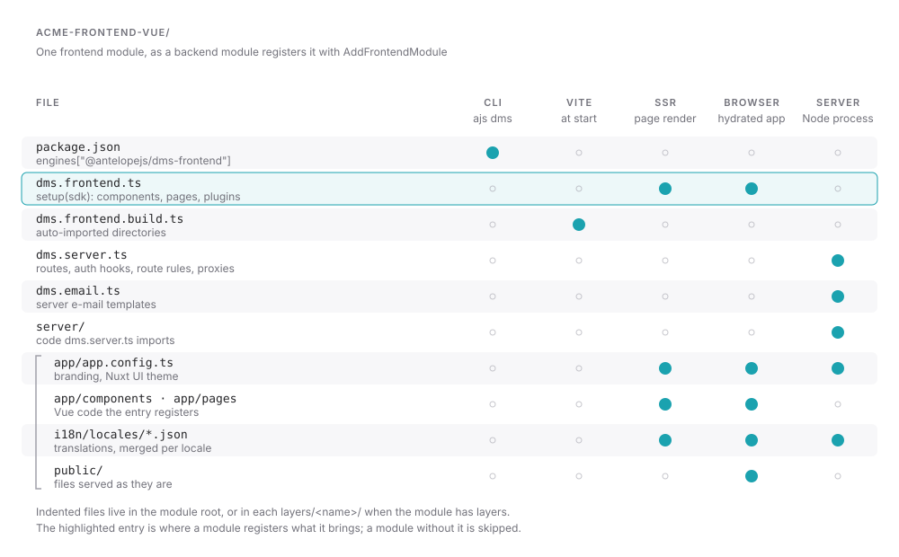

A frontend module adds Vue components, pages or server routes to a DMS dashboard. Its source lives in your backend module, usually in `frontend-vue/`. The CLI copies it into a generated workspace under `~/.antelopejs/dms-frontend/` and replaces those copies on every run, so edits made there are lost.

The smallest end-to-end example, a route you can call with `curl`, is in [Return your first response](/docs/frontend/frontend-modules/server-routes#return-your-first-response).



The backend side registers the module and the renderer it targets:

```ts [src/index.ts]
import path from "node:path";
import { AddFrontendModule } from "@antelopejs/interface-dms/page";

await AddFrontendModule({
  name: "@acme/dms-billing-frontend-vue",
  sourcePath: path.join(__dirname, "../frontend-vue"),
  renderer: { name: "vue", version: "3" },
});
```

The registration also carries what the frontend server needs to know about the backend. Those are `publicEndpoints`, `backendProxies` and `authEstablishEndpoints`, covered in [Deployment](/docs/frontend/deployment/routing-and-proxy). The [Distributable module](/docs/building/distributable-module) page of the DMS guide covers the backend half.

## Layers

A module keeps its application code, translations, public files and app config either at its root or in layers, one directory each under `layers/<name>/`. Inside the workspace, every layer answers to the `#<name>` alias. That is how the DMS core module exposes `#dms-core` and `#dms-ui`. When two layers of one module hold the same file, the layer whose name sorts last wins.

## Translations

Each root or layer keeps its catalogs under `i18n/locales/`, one JSON file per language. The file name ends in `<language>-<REGION>.json`, as in `en-GB.json` or `billing-en-GB.json`. The CLI merges every module's catalogs into one per language, in manifest-priority order.

The CLI compiles each message with the vue-i18n message compiler while it merges the catalogs. A message that does not compile stops `ajs dms build` and the start of `ajs dms dev`. The error names the file, the key and the message to write instead. vue-i18n reserves `@`, `{`, `}` and `|`, so a literal one is written `{'@'}`, `{'{'}`, `{'}'}` or `{'|'}`:

```text
Invalid locale file frontend-vue/i18n/locales/billing-en-GB.json: 1 message(s) vue-i18n cannot compile:
auth.email.placeholder: Invalid linked format in "first.last@example.com". Write a literal @ as {'@'}: "first.last{'@'}example.com".
```

## The `dms.frontend.ts` entry

A module opts into the Vue renderer with a `dms.frontend.ts` file at its root. Its default export receives the SDK. It imports the SDK types from the `#dms/frontend-module` alias, which the loader resolves to the generated `frontend-module.ts`.

```ts fragment [dms.frontend.ts]
import MyBlock from "./components/MyBlock.vue";
import ReportsPage from "./pages/ReportsPage.vue";
import type { DmsFrontendModule } from "#dms/frontend-module";

const frontendModule: DmsFrontendModule = {
  setup(sdk) {
    sdk.registerComponent("MyBlock", MyBlock);
    sdk.registerPage("reports", ReportsPage);
  },
};

export default frontendModule;
```

`registerComponent` makes a component available by name. It does not place the component on a page. `registerPage("reports", ...)` selects a renderer for a matching backend page. It does not create a `/reports` backend route or a menu entry, so the page must exist in the DMS for the renderer to show.

The SDK that `setup` receives has these methods:

| Method | Registers |
| --- | --- |
| `registerComponent(name, component, options?)` | A component that every template and backend page tree can name. See [Components](/docs/frontend/frontend-modules/components). |
| `registerPage(name, component, preload?)` | A page. The name is matched against the page's component name, then its route's `fullSlug`, then its request path, without leading or trailing slashes. |
| `registerDynamicPage(name, component, preload?)` | The page that renders a route no registered page matches. The one named `[...slug]` comes first, then the one named `default`. |
| `registerLayout(name, component, preload?)` | A layout that pages render in |
| `registerErrorPage(component, preload?)` | The error page |
| `registerPlugin(setup, options?)` | A plugin that runs when the application starts, on the server and in the browser. With `{ clientOnly: true }` it runs in the browser only. |
| `registerMiddleware(name, handler, options?)` | A navigation middleware. `{ global: true }` runs it on every navigation. `{ parallel: true }` starts it together with its parallel neighbours. |
| `registerAccessRedirect(code, path)` | Where a page visit refused with a typed `403` goes. See [Redirecting typed access refusals](#redirecting-typed-access-refusals). |
| `provide(key, value)` | A value for Vue's `inject` |
| `use(plugin)` | A Vue plugin |

`sdk.options` holds the module's public options from the manifest. When a page tree names a component that no module registers, the DMS page renderer draws a plain `div` in its place, with the node's children inside.

## Order and idempotency

Entries run by descending manifest priority, then by module id. Within one setup, the first module to register a name keeps it. The generated loader skips a module that has no `dms.frontend.ts`.

Plugins registered with `registerPlugin(setup, { enforce: "pre" })` run before the default plugins, whatever their module's priority. Plugins with `{ enforce: "post" }` run after them. Each group keeps the modules' priority order. A plugin that sets up context other plugins read, such as the async data scope, uses `pre`.

`ajs dms dev` sets every module up again, into empty registries, each time a change to a layer reaches the server renderer. A `setup` can therefore run more than once in one process. It registers what it brings and keeps no state of its own between runs.

## Redirecting typed access refusals

A backend can refuse a whole surface with a typed `403` whose body is a machine-readable code. A tenant gate that blocks a suspended workspace is one case. A module that owns such a code registers where a refused page visit goes instead of the error page:

```ts fragment [dms.frontend.ts]
sdk.registerAccessRedirect(
  "saas.errors.workspace.access_blocked",
  "/workspace-suspended",
);
```

The server answers the refused visit, document or Inertia, with a redirect before anything renders, so a reload lands on the destination directly. The body is either the bare code or JSON, as `"code"` or `{ "message": "code" }`. When the destination is itself the refused path, the visit shows the error page instead of looping. The first registration of a code wins, in manifest-priority order.

## The other entries

| File | Runs | Page |
| --- | --- | --- |
| `dms.frontend.build.ts` | In Node.js, when Vite starts | [Auto-imports](/docs/frontend/frontend-modules/auto-imports) |
| `dms.server.ts` | In the frontend server | [Server routes](/docs/frontend/frontend-modules/server-routes) |
| `dms.email.ts` | In the e-mail renderer of the frontend server | [E-mails](/docs/frontend/frontend-modules/emails) |
| `app/app.config.ts` | In the browser, the server render and the e-mail renderer | [App config](/docs/frontend/frontend-modules/app-config) |
| `package.json` | Read by the CLI before it builds anything | [Supported releases](/docs/frontend/frontend-modules/supported-releases) |
