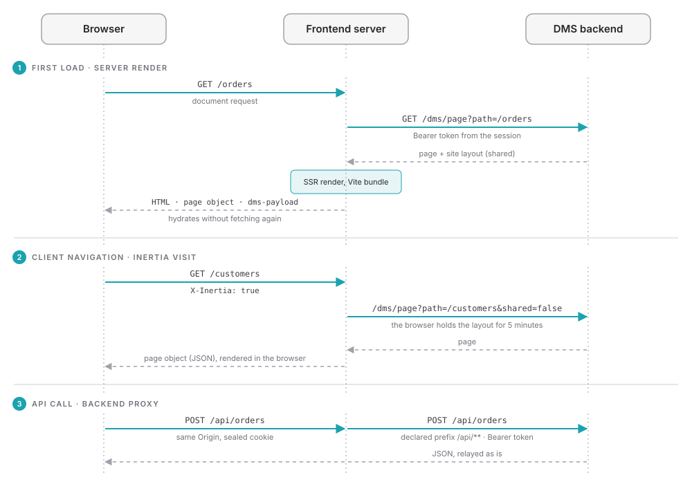

# Rendering model

The generated application is an Inertia application that the frontend server renders. It owns page resolution, server-side rendering, hydration and the root Vue tree; every frontend module owns its `dms.frontend.ts` entry and registers into it. The same generated registry of frontend modules drives the server and the browser entries.

## First load: a server render

A full-page request reaches the frontend server, which resolves its owner. For a page, the server asks the backend for it at `/dms/page?path=…`, with the access token of the session, renders it through the Vite SSR bundle, and answers with:

- the HTML of the page;
- the Inertia page object the browser hydrates with: the page (its route and layout), the session (`user`, `session`) and the site layout (`shared`);
- one `<script id="dms-payload" type="application/json">` holding the data the page's components loaded, their failures and the state they chose to transfer, so the browser hydrates without loading it again. See [Data loading](/docs/frontend/rendering/data-loading).

A route rule can turn the server render off for a page with `ssr: false`: its document requests then get the client-rendered shell. See [Route rules](/docs/frontend/frontend-modules/route-rules).

## Navigation: Inertia visits

Once the page is hydrated, following a link is an `X-Inertia` visit. The server answers with a page object in JSON, and the browser renders it. The site layout is an Inertia once prop: while the browser holds a copy less than five minutes old, the server asks the backend for the page alone, with `shared=false`. See [Navigation](/docs/frontend/rendering/navigation).

## API calls: the backend proxy

The browser calls the backend through the frontend server, on the prefixes the modules declare, such as `/api/**` and `/dms/**`. The server adds the session's access token to the forwarded request, so the token never reaches the browser. See [Routing and the backend proxy](/docs/frontend/deployment/routing-and-proxy).

## Browser-only work

Client-only plugins, registered with `{ clientOnly: true }`, and the `DmsClientOnly` component defer browser-only work until the application runs in the browser. Everything else runs on both sides, so a component's `setup` must not touch browser globals unguarded.

## The request a render reads

A server render may read the headers of the request it answers with `useDmsRequestHeader(name)`, for instance to print a keyboard hint for the visitor's platform on a first visit. It returns `undefined` in the browser, which has no request: hand the browser what the page rendered from a header with `useDmsState(key, init, { transfer: true })`, so that hydration starts from the same value.

- **The answer varies on what the render read.** Every header a render reads is added to the document's `Vary`, so a shared cache in front of a [public `cache` rule](/docs/frontend/frontend-modules/route-rules) keeps one copy per value instead of serving one visitor's page to another. Read few headers, and only when needed: `Vary: User-Agent` makes such a cache keep almost one copy per visitor.
- **No cookies, no credentials.** `Cookie`, `Authorization` and `Proxy-Authorization` always read `undefined`. Cookies go through `useDmsCookie`; credentials stay with the server.
- **What is rendered is public.** A header's value written into the page, or into transferred state, is readable by the page's scripts. Render what a header means (`mac` or `other`), not the header.

## Favicons

A page whose render declares no icon through `useHead` gets an empty `<link rel="icon" href="data:,">`, which keeps the browser from asking for `/favicon.ico`. A page that declares its icons, one per color scheme for instance, gets only those.

## Hot reload in development

Under `ajs dms dev`, edits to translations, app configs and public files reach the open page without a reload, and an edited component is used by the next server render without a restart. The [dev command](/docs/frontend/cli/dev#what-reloads-and-how) lists what each kind of edit does.
