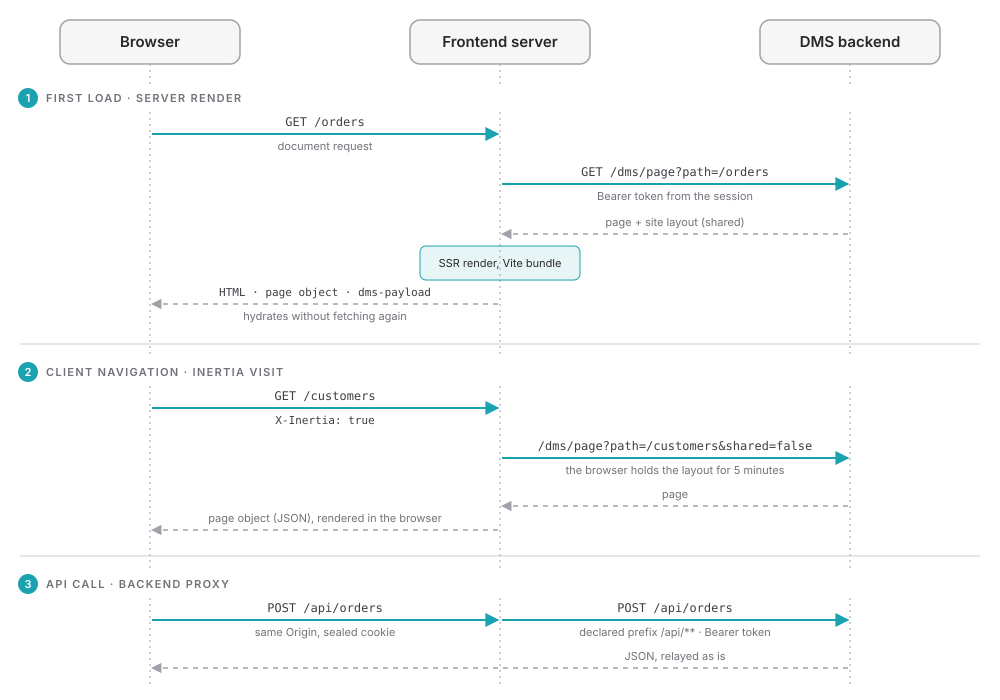

The generated application is an Inertia application that the frontend server renders. The application owns page resolution, server-side rendering, hydration and the root Vue tree. Each frontend module owns its `dms.frontend.ts` entry and registers into the application. One generated registry of frontend modules drives both the server entry and the browser entry.



## First load: a server render

A full-page request reaches the frontend server, which finds the module that owns the path. For a page, the server asks the backend for it at `/dms/page?path=…` with the session's access token. It renders the page through the Vite SSR bundle and answers with three things:

- The HTML of the page.
- The Inertia page object that the browser hydrates with. It holds the page (its route and layout), the session (`user` and `session`) and the site layout (`shared`).
- One `<script id="dms-payload" type="application/json">` element. It holds the data that the page's components loaded, their failures, and the state they chose to transfer, so the browser hydrates without loading that data again. See [Data loading](/docs/frontend/rendering/data-loading).

A route rule can turn off the server render for a page with `ssr: false`. Document requests for that page then get the client-rendered shell. See [Route rules](/docs/frontend/frontend-modules/route-rules).

## Navigation between pages

Once the page has hydrated, following a link is an `X-Inertia` visit. The server answers with a page object in JSON, and the browser renders it.

The site layout is an Inertia once prop. The browser keeps the copy it was sent for five minutes. While it holds a copy for the same account and workspace, the server asks the backend for the page alone, with `shared=false`. See [Navigation](/docs/frontend/rendering/navigation).

## API calls: the backend proxy

The browser calls the backend through the frontend server, on the prefixes that the modules declare, such as `/api/**` and `/dms/**`. The server adds the session's access token to the forwarded request, so the token never reaches the browser. See [Routing and the backend proxy](/docs/frontend/deployment/routing-and-proxy).

## Browser-only work

Two tools defer browser-only work until the application runs in the browser. One is a client-only plugin, registered with `{ clientOnly: true }`. The other is the `DmsClientOnly` component. Everything else runs on both sides, so a component's `setup` must guard any use of browser globals.

While the browser hydrates the page that the server rendered, every component must draw what the server drew. The auto-imported `isDmsHydrating()` returns whether the browser is doing that now. It returns `true` from the start of the application to the tick in which the page has hydrated. It returns `false` on the server, in a page that the server did not render, and after a client navigation.

Take a component that shows a value only the browser knows, such as local storage or the clock. It reads `isDmsHydrating()` in its `setup`. While hydrating, it draws the server's version and switches once mounted. Anywhere else, it draws the browser's version at once.

`ref`, `onMounted` and `isDmsHydrating` are auto-imports of the renderer, so a component uses them without an import. The `declare` lines only give this example the types that those auto-imports carry:

```ts
declare const ref: typeof import("vue").ref;
declare const onMounted: typeof import("vue").onMounted;
declare const isDmsHydrating: typeof import("@antelopejs/dms-frontend/templates/vue/frontend-module").isDmsHydrating;

const isDrawn = ref(!import.meta.env.SSR && !isDmsHydrating());
onMounted(() => (isDrawn.value = true));
```

## Favicons

A page whose render declares no icon through `useHead` gets an empty `<link rel="icon" href="data:," />`. Without any icon link, the browser would ask for `/favicon.ico`, and the frontend server would pass that request on to the backend on every page load. A page that declares its own icons, for example one per color scheme, gets only those.

## Keyboard hints

Nuxt UI prints the `meta`, `ctrl` and `alt` keys of its key hints for the visitor's keyboard. The hints include `<UKbd value="meta">`, the `kbds` of its menus, and the dashboard search button. A Mac shows "⌘", and other systems show "Ctrl". Nuxt UI learns the keyboard only once the page runs in the browser. On its own, a hint therefore renders blank on the server and in a hydrating component, and fills in once that component has mounted.

An application that knows the keyboard during the server render passes it to every hint with `provideDmsKbdPlatform(app, source)`, called from a plugin. Each component that prints a hint calls `source` in its setup. `source` returns a ref of `"mac"` or `"other"`. On the server, it must return the platform that the page renders for. It must keep that value while its caller hydrates, so that the browser's first render matches the server's HTML.

## Hot reload in development

Under `ajs dms dev`, edits to translations, app configs and public files reach the open page without a reload. The next server render uses an edited component without a restart. The [dev command](/docs/frontend/cli/dev#what-reloads-and-how) lists what each kind of edit does.
