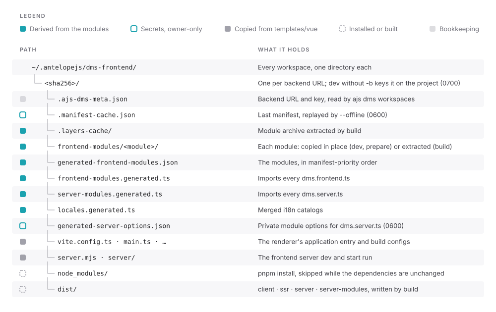

Every command that generates something writes it into a workspace. Under `~/.antelopejs/dms-frontend/<sha256>/`, a workspace is a directory that only its owner can read. It holds the materialized modules, the generated files, the installed dependencies, the manifest cache and the build output.

## One workspace per backend

Each canonical backend URL gets its own workspace under `~/.antelopejs/dms-frontend/`. `prepare`, `clean -b` and `dev -b` all key the workspace on that URL, so they share one workspace per backend. A production build works differently. `build` and `start` use `<project>/.dms-frontend`, or the directory that `--workspace <dir>` names.

Equivalent spellings of a URL map to the same key. The scheme and the host are lowercased, `localhost` and `[::1]` become `127.0.0.1`, and default ports and a bare trailing slash are dropped.

`dev` without `-b` is the exception, and on purpose. It discovers the backend from the enclosing project's `.antelope/dev.json` and keys its workspace on the **project directory**. A development backend can land on another port between runs, and a key on the URL would then discard `node_modules` and the manifest cache each time.

::warning
`ajs dms dev` followed by `ajs dms prepare -b <url>` against the same backend creates two workspaces, each with its own installed dependencies. Pass `-b` to `dev` to share a single workspace. [`ajs dms workspaces`](/docs/frontend/cli/workspaces) lists both, and [`ajs dms clean -b <url>`](/docs/frontend/cli/clean) reaches only the workspace keyed on the URL.
::

The server's cookie names end with the first 12 hexadecimal characters of the SHA-256 of the canonical backend URL. Browsers scope cookies by hostname and not by port, so this suffix keeps two frontends of different backends on one host from overwriting each other's session. The suffix follows the backend URL, so a restart keeps the cookies that the server wrote.

## Permissions

The workspace directory under `~/.antelopejs` has mode `0700`. In `dev` and `prepare`, two files carry private values, and both have mode `0600`:

- The manifest cache, `.manifest-cache.json`, stores the backend's answer as sent, private module options included.
- `generated-server-options.json` holds the private options that `dms.server.ts` reads.

The CLI writes both files through a temporary file, so a copy that other users can read never exists, even when an older copy of the file had wider permissions.

A `build` keeps no private value. It empties the private options in `generated-server-options.json`, which has mode `0644`, and the server reads its secrets from its environment. For the same reason, the CLI creates a build's workspace with the default permissions.

## The manifest cache

Each successful `dev` or `prepare` run caches the manifest in the workspace. `build` reads no manifest.

| Command | Backend unreachable or failing | With `--offline` |
| --- | --- | --- |
| `dev` | Uses the cache, with a warning | Uses the cache |
| `prepare` | Uses the cache, with a warning. Skips when there is none | Uses the cache. Skips when there is none |

An authorization failure never falls back to the cache. The cache can hold private options from an earlier authorized run, and a replay of those options would bypass the credential.

## Dependencies

The workspace installs its dependencies with pnpm once, and again only when a module's dependencies change. `--force` reinstalls them. The CLI strips a module's own lifecycle scripts, such as `preinstall`, `postinstall` and `prepare`, from the module's copy, so installing the workspace never runs them.
