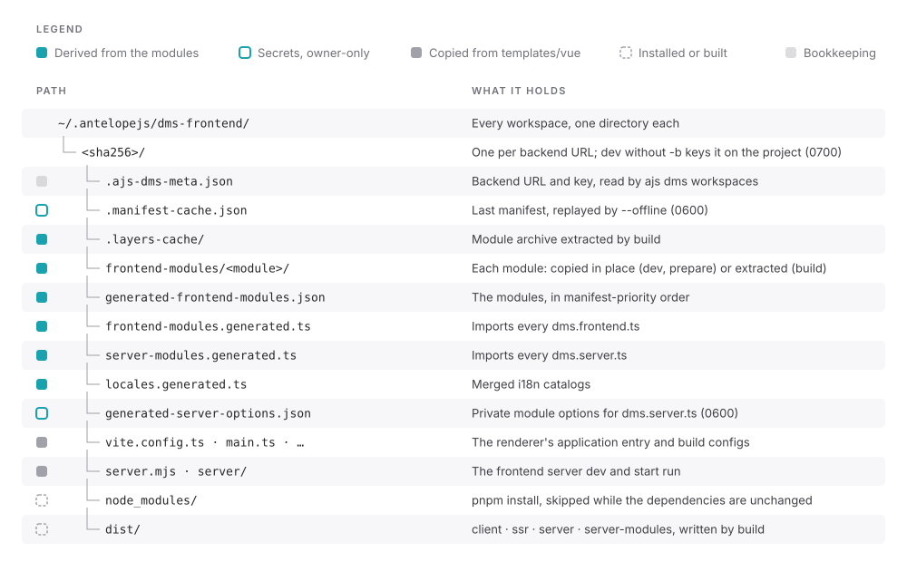

# Workspaces and cache

Every command that generates something writes it into a workspace: an owner-only directory under `~/.antelopejs/dms-frontend/<sha256>/` that holds the materialized modules, the generated files, the installed dependencies, the manifest cache and the build output.

## One workspace per backend

Each canonical backend URL gets its own workspace. `build`, `start`, `prepare`, `clean -b` and `dev -b` all key on that URL, so one backend means one workspace shared by every command. Equivalent spellings map to the same key: the scheme and host are lowercased, `localhost` and `[::1]` become `127.0.0.1`, default ports and a bare trailing slash are dropped.

`dev` without `-b` is the deliberate exception. It discovers the backend from the enclosing project's `.antelope/dev.json` and keys its workspace on the **project directory**, because a development backend can land on another port between runs, and re-keying on the URL would discard `node_modules`, the manifest cache and the browser's storage scope every time.

::warning
`ajs dms dev` followed by `ajs dms build -b <url>` against the same backend creates two workspaces, a few hundred megabytes each. Pass `-b` to `dev` to share a single one. [`ajs dms workspaces`](/docs/frontend/cli/workspaces) lists both, and [`ajs dms clean -b <url>`](/docs/frontend/cli/clean) only reaches the URL-keyed one.
::

The workspace's full SHA-256 also scopes what the dashboard keeps in the browser, such as local storage, cookies and persisted state, so two backends served from the same origin never share it.

## Permissions

The workspace directory under `~/.antelopejs` is `0700`. In `dev` and `prepare`, the manifest cache, `.manifest-cache.json`, stores the backend's answer verbatim, private module options included, and `generated-server-options.json` holds the private options `dms.server.ts` reads: both are `0600`, written through a temporary file so a world-readable copy never exists, even for a workspace created before this hardening.

A `build` keeps no private value: it empties them in both files, which are then readable by other users, and the server reads its secrets from its environment. A workspace named with `--workspace` is created with the default permissions, for the same reason.

## The manifest cache

Each successful run caches the manifest, and `build` the extracted module archive, in the workspace.

| Command | Backend unreachable or failing | With `--offline` |
| --- | --- | --- |
| `dev` | Uses the cache, with a warning | Uses the cache |
| `prepare` | Uses the cache, with a warning; skips when there is none | Uses the cache; skips when there is none |
| `build` | Exits 1, saying whether a cache exists and how old it is | Builds from the cached manifest and archive, with a warning |

An authorization failure never falls back to the cache: it can hold private options from an earlier authorized run, and replaying them would defeat the credential.

## Dependencies

The workspace installs its dependencies with pnpm, once, and again only when a module's dependencies change. `--force` reinstalls them; for `build`, it also extracts the module archive from scratch. A module's own lifecycle scripts (`preinstall`, `postinstall`, `prepare` and the like) are stripped from its copy, so installing the workspace never runs them.
